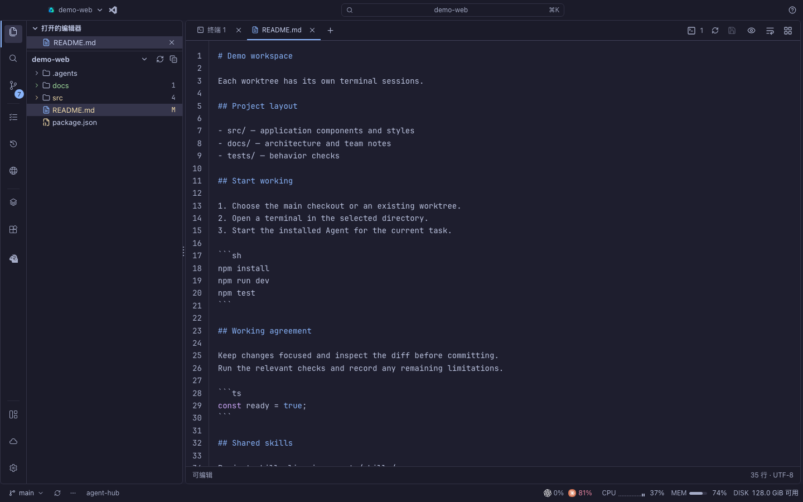
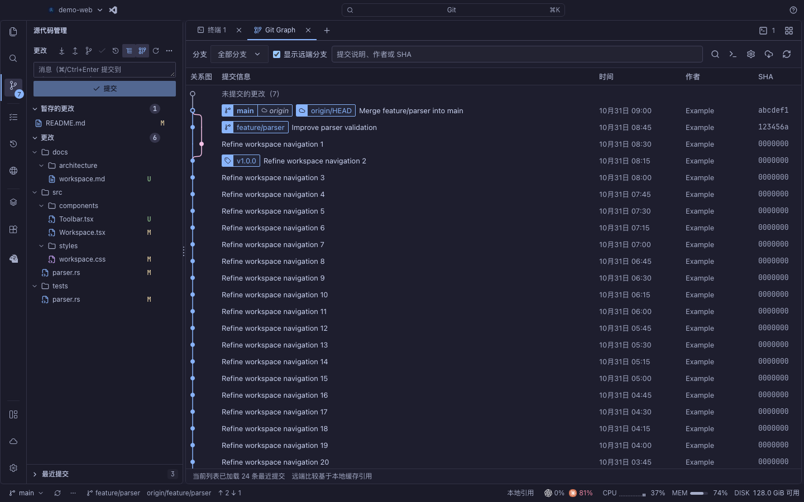
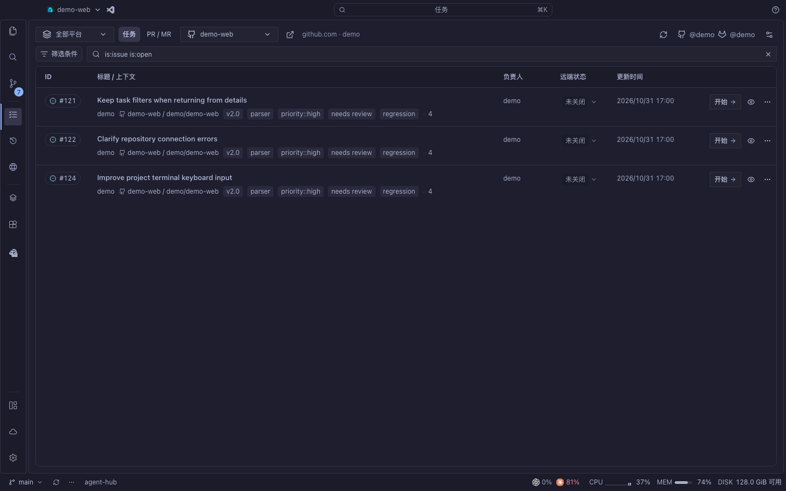
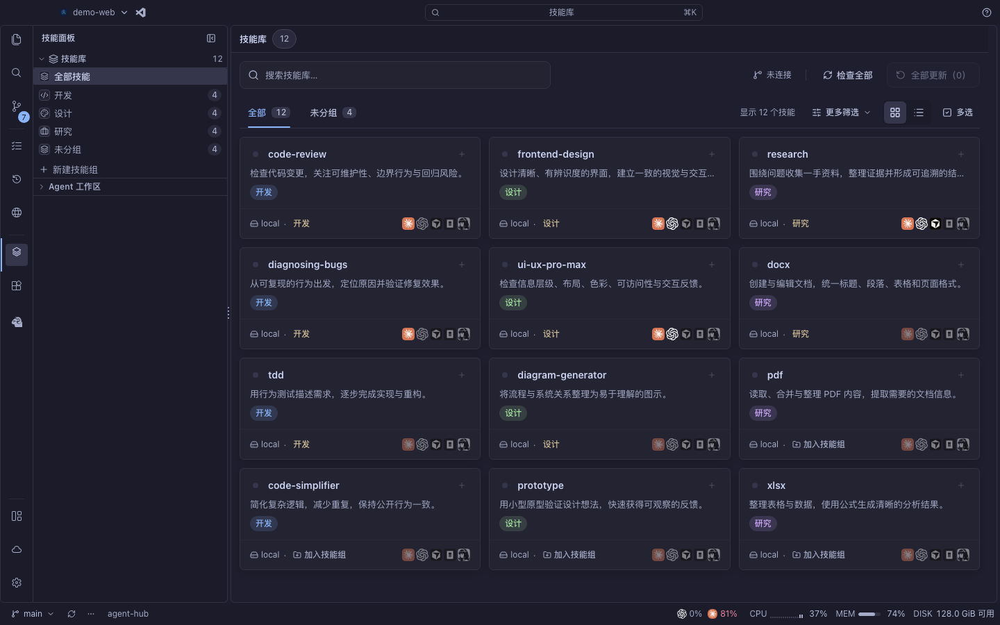
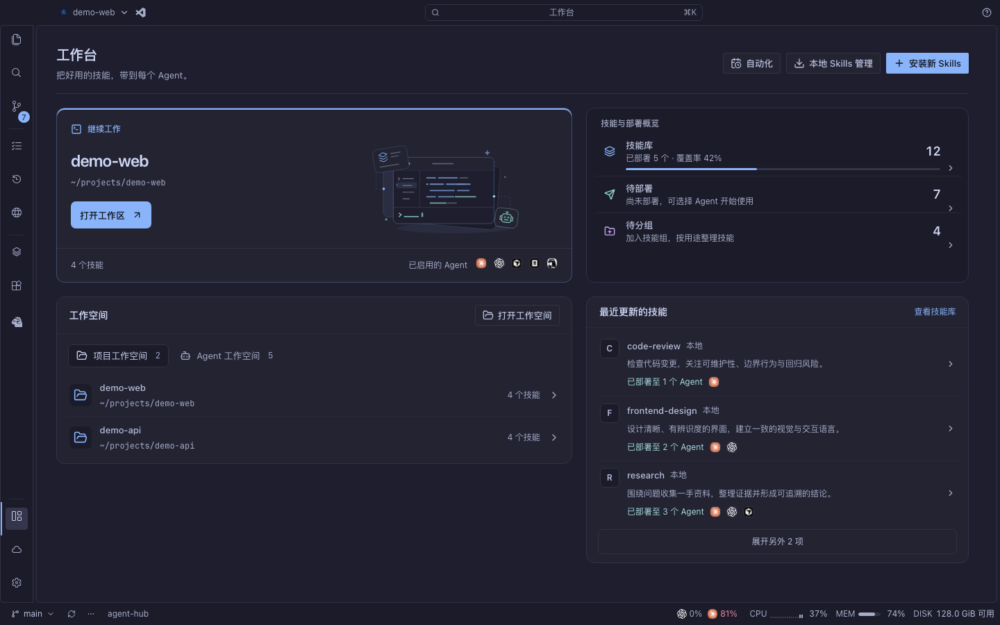
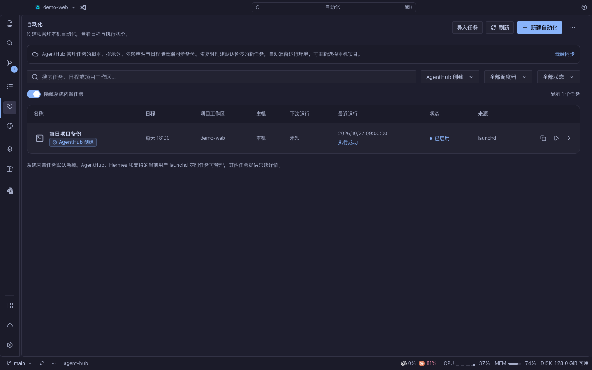
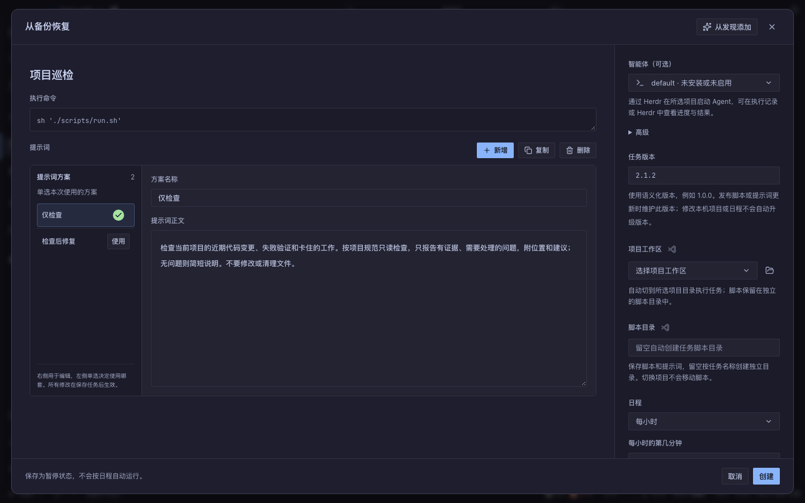
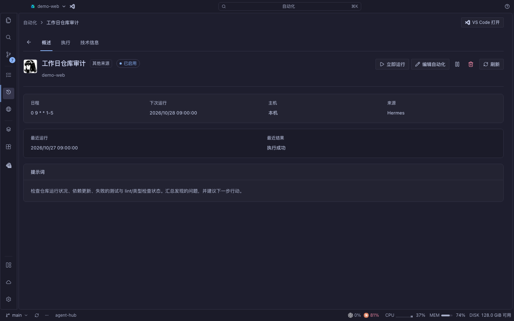
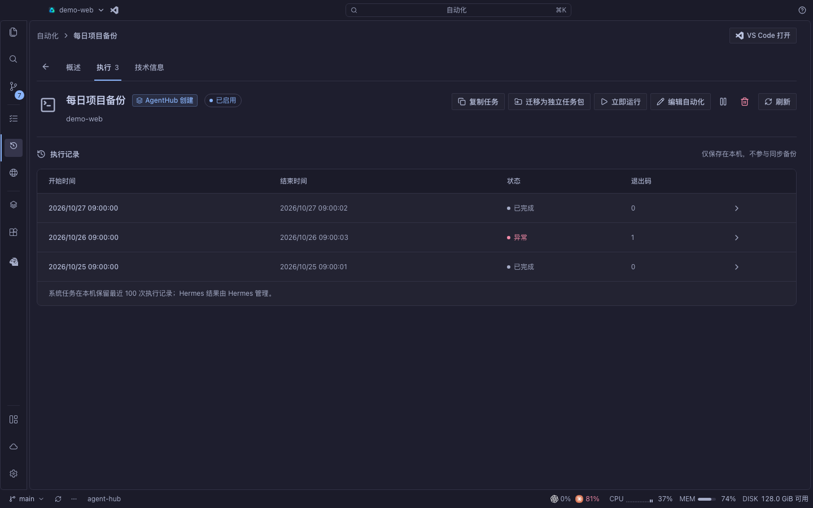
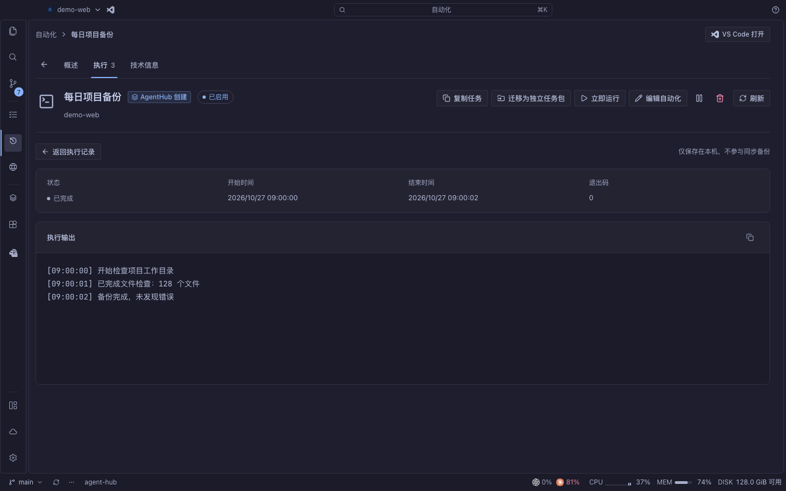

<div align="center">
  
  <h1>AgentHub</h1>
  <p><strong>让 Agent 围绕项目工作。</strong></p>
  <p>本地优先的 AI 开发工作台，连接项目、Agent、Skills 与定时任务。</p>
  <p>
    <a href="https://jtblink.github.io/agent-hub/">产品主页</a> ·
    <a href="https://github.com/JTBlink/agent-hub/releases">下载安装包</a> ·
    <a href="docs/README.md">文档</a> ·
    <a href="CHANGELOG.md">更新日志</a>
  </p>
</div>



_截图来自当前开发界面的合成数据预览，不读取本机项目、账号或任务。已发布安装包的功能以对应版本说明为准。[截图说明与生成命令](docs/images/README.md)。_

## 从项目到 Agent，在一个工作台里完成

选择项目与 Git 工作树，打开文件、终端或预览，在当前目录启动 Agent；按需要部署技能、查看 Git 变更与平台任务，再把重复工作配置为定时任务。

| 能力         | 可以做什么                                                                               |
| ------------ | ---------------------------------------------------------------------------------------- |
| 项目与工作树 | 切换项目及 Git worktree，浏览文件，查看和编辑文本、Markdown。                            |
| 终端与 Agent | 多标签、分屏和当前目录启动 Codex、Claude Code、OpenCode、Hermes；可接入 Herdr 管理会话。 |
| Git          | 查看变更、差异、提交图、分支和标签，比较图片版本，通过统一菜单执行仓库操作。             |
| 任务平台     | 连接 GitHub / GitLab，管理登录账号及私有站点，按多个项目查看 Issue、PR / MR 和 CI 状态。 |
| Skills       | 从本地或 Git 导入、检查版本，用标签和技能组整理，部署到 Agent 的全局或项目工作空间。     |
| 自动化       | 创建命令或 Agent 定时任务，编辑日程、脚本和提示词方案，复制、导入导出并查看执行记录。    |
| 浏览与预览   | 从项目打开网页、移动端视口或文档预览；运行环境与连接由桌面设置管理。                     |
| 备份与 CLI   | 用自己的 Git 远端备份管理内容，通过配套 CLI 管理技能、任务和桌面预览。                   |

部分集成能力可通过产品配置裁剪；标准版、个人版与 Agent Flow 定制版的功能以构建配置为准；Agent Flow 按独立配置启用 GitLab 集成。AI Native 场景编排目前仍是独立需求原型，未作为正式产品能力交付。

## 项目、Git 与平台任务

项目侧栏按工作树组织。终端、文件和预览围绕当前工作区展开；终端可以新建 Agent 标签，也可以通过 Herdr 入口连接已有会话。切换项目或工作树时会释放旧工作区的应用自有终端，返回后新建 Shell，不自动重放历史命令。

图片可在文件树中独立查看，也可比较暂存区、工作区和历史版本，支持左右／上下排列、缩放与大图查看。



任务页按 GitHub / GitLab 切换，支持多个项目合并查看、账号管理与私有站点。评审、修复或 CI 排查等操作先进入 Agent 启动预览，沿目标项目规范执行；平台登录与技能备份所使用的认证分别管理。



## 技能库与项目部署

从已有 Agent 目录、本地目录或 Git 仓库导入 Skills，查看内容、来源和版本。仓库卡片区分安装到本地、上传到仓库与详情入口；导入后的本地原目录可以删除，技能库副本仍独立保留。



导入技能库、加入技能组和部署到工作空间是三个操作。技能组整理用途；向全局或项目工作空间添加技能组时才批量部署，组内成员变化不会自动更新已有部署。普通项目的团队技能内容保存在 `.agents/skills`，适用的 Agent 专属入口通过项目相对链接或副本读取。

<details>
  <summary>查看工作台概览</summary>



</details>

## 定时任务与 Agent 自动化

从模板创建任务，或导入完整任务包；管理自己的本地实例，按需暂停、恢复、立即运行、复制或导出。编辑器支持多组提示词单选生效，详情页可以查看源码并直接通过 VS Code 打开任务目录。





命令任务使用 macOS launchd、Linux systemd timer 或 Windows 任务计划程序；Hermes 任务由 Hermes 调度。关闭桌面窗口不会删除计划，实际执行仍依赖用户会话、调度服务和任务所需工具。

Agent 任务通过共享执行器启动和检查会话。任务可按业务设置版本去重、单轮批量和修复次数上限；这些策略需要对应任务脚本实现，不能仅靠提示词视为已生效。执行未结束、等待输入或结果不明时保留检查点，避免重复投递。修复后的独立重审与项目门禁仍按任务和项目规范执行。

<details>
  <summary>查看任务详情和执行记录</summary>







系统任务在本机保留最近 100 次执行记录；Hermes 的结果文件由 Hermes 管理。执行日志、扩展业务状态、凭据与运行环境留在本机，不参与任务导出或 Git 备份。进程退出和 Agent 空闲不单独代表业务验证通过。

</details>

任务包位于 [`automations/`](automations/README.md)，以 `TASK.md` 为说明入口，`config/task.json` 保存清单，脚本、提示词和引用分别放在 `scripts/`、`prompts/`、`references/`。本机任务默认分配到 `~/.agent-hub/automations/<task-name>/`，项目工作目录单独绑定。导入、复制和备份恢复创建独立且默认暂停的实例，并准备运行依赖；没有单独的安装/卸载步骤。

通过 CLI 创建、编辑和查看任务：

```bash
agent-hub-cli --json automations templates
agent-hub-cli --json automations create --template workspace-check
agent-hub-cli --json automations list
agent-hub-cli --json automations show '<task-id>'
agent-hub-cli --json automations edit '<task-id>' --file task.json --revision '<revision>'
agent-hub-cli --json automations runs '<task-id>'
agent-hub-cli --json automations logs '<task-id>' --run '<run-id>'
```

需要执行时使用 `automations run '<task-id>'`；需要计划运行时使用 `automations resume '<task-id>'`。`run` 返回“已请求运行”，真实结果通过本次执行记录与业务证据核实。完整参数见 [CLI 说明](docs/help/zh/reference/cli.md)；Agent 使用规范见 [agent-hub-cli Skill](skills/productivity/agent-hub-cli/SKILL.md)。

## 安装与开始使用

从[发布页](https://github.com/JTBlink/agent-hub/releases)下载对应平台的安装包，可用产物与功能以该版本说明为准。

| 平台    | 安装格式             |
| ------- | -------------------- |
| macOS   | Universal `.dmg`     |
| Windows | `.exe` 安装程序      |
| Linux   | `.AppImage` / `.deb` |

1. 添加项目，选择已有工作树，打开终端或启动已安装的 Agent。
2. 导入 Skills，用标签和技能组整理，再按需部署到全局或项目工作空间。
3. 连接 GitHub / GitLab，查看当前项目的工作项和代码审查。
4. 从模板创建定时任务，核对工作目录、脚本与日程后启用。
5. 配置自己的 Git 远端，备份技能、任务定义和受支持的用户配置。

## 本地数据与备份

- 技能默认在 `~/.agent-hub/skills`，可在设置中移动技能库。
- 应用数据库为 `~/.agent-hub/agent-hub.db`；配套 CLI 在 `~/.agent-hub/bin/`。
- 独立任务包在 `~/.agent-hub/automations/`；各任务的本机绑定、环境、执行和业务记录在包内 `.local/`。
- Git 备份默认在 `~/.agent-hub/backup`，保存可移植管理内容；凭据、数据库、终端历史和任务运行状态不进入备份。
- 普通项目的团队技能在项目 `.agents/skills`，项目成员使用这些内容不依赖个人技能库。

删除任务默认保留本地文件；显式清理仅作用于该任务拥有的数据，不删除绑定项目。详见[目录与本地数据](docs/architecture/directory-structure.md)及[定时任务记录规范](docs/architecture/automation-records.md)。

## 开发与运行

需要 Node.js 22+、Rust stable 和对应平台的 Tauri 2 构建依赖。

```bash
npm ci
npm run app:dev
```

开发与打包入口自动构建、验证并更新配套 CLI；只启动 `npm run dev` 时，原生文件、数据库和终端功能需要桌面运行时。常用命令：

```bash
npm run app:build
npm run cli -- --help
npm run cli:build
npm run build
npm test
npm run lint
cargo test --manifest-path src-tauri/Cargo.toml
```

产品配置、编译裁剪及产物目录见[产品开发](docs/product-development.md)与[编译、打包和安装](docs/build-and-install.md)。

### 产品主页与截图

品牌图标保留[深色](src-tauri/icons/variants/dark/)与[浅色](src-tauri/icons/variants/light/)两套，应用、官网和截图默认使用深色版。[定稿预览](docs/images/brand-concepts/README.md)。

主页为静态 HTML、CSS 和少量 JavaScript。版本从 `VERSION` 注入，帮助站与应用离线帮助共用文档正文。

```bash
npm run website:build
python3 -m http.server 8080 --directory _site
```

在本地前端预览服务器运行时，用 `node scripts/website/capture-product-screenshots.mjs` 更新合成数据产品截图。源图片由 README 和官网构建共用，操作说明见[截图说明](docs/images/README.md)。

## 项目结构

```text
src/             React 页面、组件、状态与 Tauri bindings
src-tauri/       Rust 核心、原生能力、CLI 和桌面宿主
homepage/        产品主页静态源文件
docs/help/       应用帮助与公开文档的共享正文
docs-site/       VitePress 文档站配置
skills/          随项目提供的管理 Skill
automations/     可独立导入和维护的自动化任务包
tests/browser/   合成数据产品预览和浏览器验证
scripts/         开发、验证、版本与发布脚本
```

## 许可

[MIT](LICENSE)。第三方来源与许可证见[导入来源与许可](docs/reference/skills-manager/README.md)。
