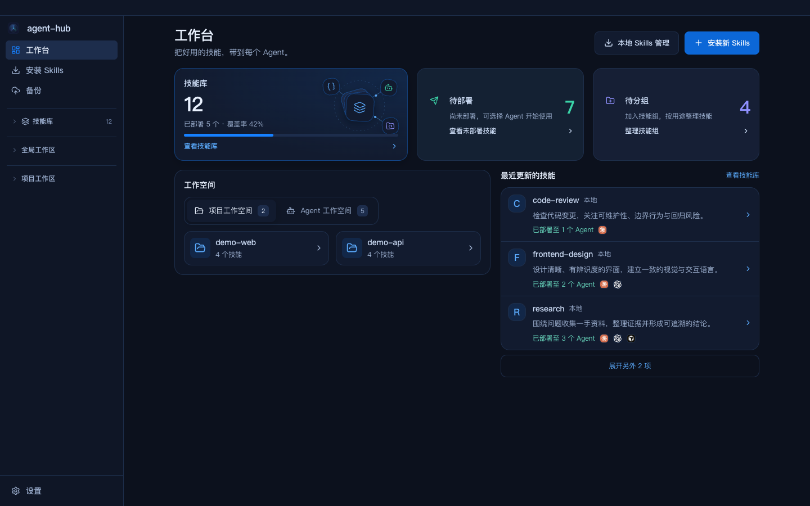
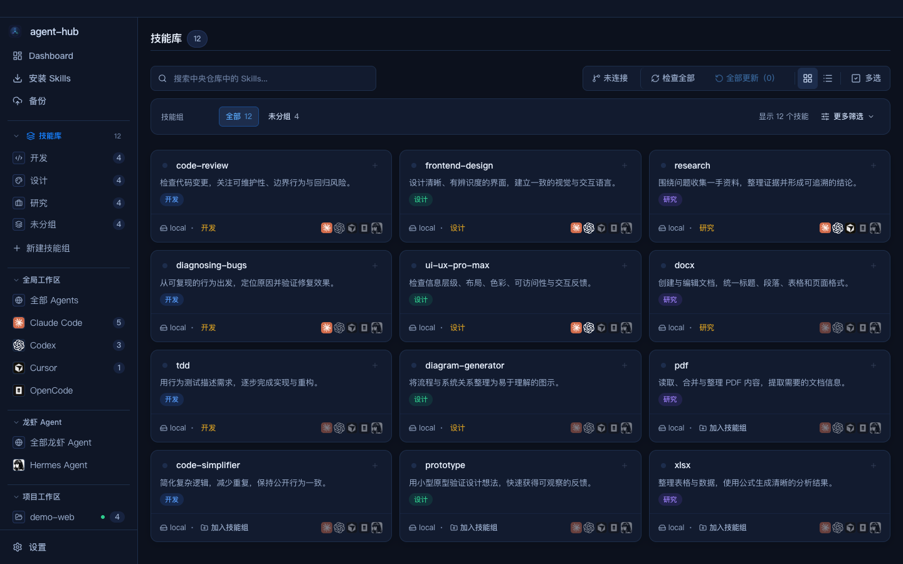

<div align="center">
  
  <h1>AgentHub</h1>
  <p><strong>把好用的 Skills，带到每个 Agent。</strong></p>
  <p>本地优先的 AI Agent Skills 工作台，统一整理技能库、技能组与项目部署。</p>
  <p>
    <a href="https://jtblink.github.io/agent-hub/">产品主页</a> ·
    <a href="https://github.com/JTBlink/agent-hub/releases">下载安装包</a> ·
    <a href="docs/README.md">文档</a> ·
    <a href="CHANGELOG.md">更新日志</a>
  </p>
</div>



_当前开发界面，使用示例数据：默认展示项目工作空间，可切换 Agent；右侧查看近期技能。截图生成方式见[截图说明](docs/images/README.md)。_

## 一个工作台，管理你的 Skills

Skills 不必散落在每个工具和项目目录里。AgentHub 集中管理技能内容，再按实际用途部署到不同工作空间，支持 Claude Code、Codex、Cursor、OpenCode、Hermes 等 Agent。

| 能力         | 用途                                                              |
| ------------ | ----------------------------------------------------------------- |
| 技能库       | 从本地目录或 Git 来源导入，查看内容与来源、检查更新、用标签筛选。 |
| 技能组       | 按开发、设计、研究等用途整理集合，向工作空间批量添加或移除技能。  |
| Agent 与项目 | 分别管理全局和项目技能，查看部署关系与同步状态。                  |
| Git 备份     | 配置自己的 Git 远端，备份、恢复技能库并处理同步冲突。             |
| 桌面与 CLI   | 使用桌面工作台、托盘或命令行；共用同一套 Rust 核心。              |

导入技能库、加入技能组和部署到工作空间是不同操作：先收藏内容，再组织用途，最后选择需要使用这些技能的 Agent 或项目。修改组内成员不会自动更新已有部署。

<details>
  <summary>查看技能库界面</summary>



_技能库的全部视图，展示已部署、待部署与未分组的示例技能。_

</details>

## 安装与开始使用

在[发布页](https://github.com/JTBlink/agent-hub/releases)选择对应平台的安装包。具体可用产物与功能以各版本发布说明为准。

| 平台    | 安装格式             |
| ------- | -------------------- |
| macOS   | Universal `.dmg`     |
| Windows | `.exe` 安装程序      |
| Linux   | `.AppImage` / `.deb` |

1. 打开 AgentHub，扫描并导入已有 Skills，或从本地目录、Git 仓库导入。
2. 用标签和技能组整理内容，选择要启用的 Agent。
3. 在全局或项目工作空间中部署所需技能，查看同步状态。
4. 按需设置 Git 远端，为技能库建立备份。

## 数据存放

技能内容默认位于 `~/.agent-hub/skills`，可在设置中移动技能库。应用数据库、配置、日志与配套 CLI 保存在 `~/.agent-hub/`，包括 `library/agent-hub.db`、`repo-config.json` 和 `bin/agent-hub-cli`。

可在设置中创建 `~/.agents/skills` 软链接，供其他 AI 工具发现技能。Git 备份默认位于 `~/.agent-hub/backup`；凭据单独保存，不进入技能备份。详见[目录结构](docs/architecture/directory-structure.md)。

## 开发与运行

需要 Node.js 22+、Rust stable 和对应平台的 Tauri 2 构建依赖。

```bash
npm ci
npm run app:dev
```

常用构建与验证命令：

```bash
npm run app:build
npm run cli -- --help
./agent-hub.sh install --dev
npm run build
npm test
npm run lint
cargo test --manifest-path src-tauri/Cargo.toml
```

`./agent-hub.sh install` 默认构建当前平台安装包；只更新开发 CLI 时使用 `./agent-hub.sh install --dev`，追加 `release` 可构建 release CLI。

开发和打包入口会先编译并放置 `agent-hub-cli`，再启动或构建桌面应用。`npm run dev` 仅启动前端服务器，文件系统和数据库功能需要 Tauri 桌面运行时。完整说明见[开发指南](.agents/skills/rust-dev/references/development.md)。

### 产品主页

主页独立于桌面应用，使用静态 HTML、CSS 和少量 JavaScript，无外部字体或运行时依赖。构建会从 `VERSION` 注入版本号，并复制样式、图标和产品截图：

```bash
npm run website:build
python3 -m http.server 8080 --directory _site
```

打开 `http://localhost:8080` 预览。也可传入自定义输出文件：`npm run homepage:build -- <output>/index.html`。构建输出目录应独立于 `homepage/` 源文件目录。

## 项目结构

```text
src/             React 页面、组件、状态及 Tauri bindings
src-tauri/       Rust commands、核心逻辑、CLI 与 Tauri 配置
homepage/        产品主页的静态源文件
docs/help/       应用帮助与公开文档的共享正文
docs-site/       VitePress 文档站配置
public/          前端静态资源与 Agent 图标
skills/          随项目提供的管理 Skill
scripts/         开发、验证、版本和发布脚本
docs/            产品文档、架构、ADR 与界面截图
.scratch/        仓库内需求与开发状态
```

## 架构与许可

AgentHub 基于 Skills Manager 二次开发，使用 Tauri 2、React、TypeScript、Rust 和 SQLite，保留 AgentHub 的 Logo 与深蓝、蓝、青、紫品牌色。

当前实现采用唯一的桌面主入口。旧配置编辑器与独立 Skills 窗口已移除；旧数据不自动迁移，也不会因此删除。不会自动读取 `~/.skills-manager` 或 `~/.agenthub` 数据。

应用更新入口指向本项目发布页。GitHub 备份支持令牌或普通 Git；设备码登录需构建时设置项目自己的 `VITE_AGENTHUB_GITHUB_OAUTH_CLIENT_ID`。

[文档索引](docs/README.md) · [后续规划](docs/plans/agent-hub.md) · [架构说明](docs/architecture/overview.md)

本项目使用 [MIT 许可证](LICENSE)。导入代码的[来源说明与原许可证](docs/reference/skills-manager/README.md)保留，此前架构可通过 Git 历史查阅。

## 开源致谢与第三方许可

感谢以下开源项目及其贡献者。AgentHub 基于 Skills Manager 二次开发，并使用以下主要组件：

| 项目                                                                                                                     | 用途                   | 许可证                                                       |
| ------------------------------------------------------------------------------------------------------------------------ | ---------------------- | ------------------------------------------------------------ |
| [Skills Manager 来源资料](docs/reference/skills-manager/README.md)                                                       | 原始应用实现与部分资源 | [MIT（保留原始声明）](docs/reference/skills-manager/LICENSE) |
| [Tauri](https://github.com/tauri-apps/tauri)、[Tauri Plugins](https://github.com/tauri-apps/plugins-workspace)           | 桌面应用框架与系统能力 | MIT 或 Apache-2.0                                            |
| [React](https://github.com/facebook/react)、[React Router](https://github.com/remix-run/react-router)                    | 界面与路由             | MIT                                                          |
| [TypeScript](https://github.com/microsoft/TypeScript)                                                                    | 前端类型检查           | Apache-2.0                                                   |
| [Vite](https://github.com/vitejs/vite)、[Vitest](https://github.com/vitest-dev/vitest)                                   | 前端构建与测试         | MIT                                                          |
| [Tailwind CSS](https://github.com/tailwindlabs/tailwindcss)、[tailwind-merge](https://github.com/dcastil/tailwind-merge) | 界面样式               | MIT                                                          |
| [Lucide](https://github.com/lucide-icons/lucide)                                                                         | 界面图标               | ISC（部分继承图标另有 MIT 声明，以原项目许可证为准）         |
| [dnd-kit](https://github.com/clauderic/dnd-kit)                                                                          | 拖放交互               | MIT                                                          |
| [hello-pangea/dnd](https://github.com/hello-pangea/dnd)                                                                  | 拖放交互               | Apache-2.0                                                   |
| [i18next](https://github.com/i18next/i18next)、[react-i18next](https://github.com/i18next/react-i18next)                 | 国际化                 | MIT                                                          |
| [react-markdown](https://github.com/remarkjs/react-markdown)、[remark-gfm](https://github.com/remarkjs/remark-gfm)       | Markdown 展示          | MIT                                                          |
| [Serde](https://github.com/serde-rs/serde)、[Reqwest](https://github.com/seanmonstar/reqwest)                            | 序列化与网络请求       | MIT 或 Apache-2.0                                            |
| [Tokio](https://github.com/tokio-rs/tokio)                                                                               | 异步运行时             | MIT                                                          |
| [rusqlite](https://github.com/rusqlite/rusqlite)                                                                         | SQLite 数据库访问      | MIT                                                          |
| [SQLite](https://www.sqlite.org/copyright.html)                                                                          | 本地数据库引擎         | Public Domain（公有领域）                                    |
| [git2-rs](https://github.com/rust-lang/git2-rs)                                                                          | Git 备份与同步         | MIT 或 Apache-2.0                                            |

本表为主要项目的致谢摘要，不是完整的依赖、版权或许可证清单。直接依赖与具体版本见 [package.json](package.json)、[Cargo.toml](src-tauri/Cargo.toml) 及对应锁文件；传递依赖和随附资源仍适用各自的许可。本项目的 MIT 许可证不替代或重新授权第三方代码、图标、商标及导入的 Skills。复制、修改或再分发时，应按各组件的实际许可证保留版权声明、许可证全文及适用的 NOTICE 等材料；本节不能替代这些要求。许可原文参见 [MIT](https://opensource.org/license/mit) 与 [Apache-2.0](https://www.apache.org/licenses/LICENSE-2.0)。

## 免责声明与权利说明

- **独立项目与品牌归属**：AgentHub 为独立开发项目。文档和界面中的 Claude Code、Codex、Cursor、GitHub 等第三方名称、Logo 与商标归各自权利人所有，仅用于识别兼容工具、服务或说明来源，不表示本项目获得其官方认证、赞助、背书或存在隶属关系。开源代码许可不代表获得相关商标的使用授权。
- **软件按现状提供**：在适用法律允许的范围内，本软件按“现状”提供，不作适销性、特定用途适用性或不侵权等明示或默示保证；作者与版权持有人的责任限制以 [MIT 许可证](LICENSE) 为准。本说明不排除适用法律规定不得排除的责任。
- **第三方内容与服务**：用户导入、部署或分享的 Skills、脚本及其他内容仍受其原始许可证和使用条款约束。使用前请确认来源、授权与执行行为；连接 Agent、模型服务或 Git 远端时，应遵守相关服务条款，妥善管理凭据与敏感数据。第三方服务的费用、可用性及其生成内容由相应服务条款约定，本项目不作保证。
- **备份与操作风险**：部署、覆盖、删除和同步可能修改本地或远端文件。执行前请备份重要数据，检查操作目标及变更内容。
- **权利反馈**：如认为本项目中的代码、图标、名称或其他资源存在授权或署名问题，请通过[仓库维护者的公开联系方式](https://github.com/JTBlink)提供相关文件路径、权利依据及具体诉求。维护者将核实，并按核实结果补充署名、修正许可说明或移除相关内容。

帮助文档维护见 [共享帮助内容](docs/help/README.md)。本地文档站预览使用 `npm run docs:dev`；应用、测试和构建会自动准备离线文档。
