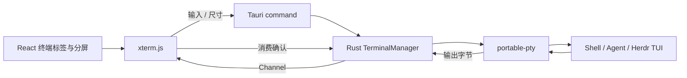

# AgentHub 内嵌终端 Rust 技术方案

状态：选型已确认；实现与原生验证状态以对应开发 Issue 为准。更新时间：2026-10-31。

配套：[任务与终端 PRD](github-gitlab-tasks-terminal-prd.md)、[终端原型](../prototypes/tasks-terminal.html?view=terminal)。

对应开发规格：[GitHub Issue #230](https://github.com/JTBlink/agent-hub/issues/230)；实现状态与后续子任务以 Issue 为准。

## 范围与选型

采用 **Tauri 2 + React + xterm.js + Rust portable-pty**。xterm.js 负责终端协议和渲染；portable-pty 负责伪终端及自有进程。保留当前 GUI，不引入 GPUI，也不自己绘制终端网格。[xterm.js](https://github.com/xtermjs/xterm.js)、[portable-pty](https://docs.rs/portable-pty/latest/portable_pty/)。

终端可运行 Shell、CLI Agent 或 Herdr TUI。Herdr 在当前终端窗格中运行，其工作空间、Agent 状态、输出与交互由 Herdr 自己展示。本方案不做 Herdr 执行历史、不解析屏幕推测状态、不另建任务编排器或后台终端服务。

工程沿用 Tauri 2、Tokio、UUID 和 Base64；本需求增加通用 PTY，并引入 `@xterm/xterm`、`@xterm/addon-fit` 和 `portable-pty`；本次查阅的 portable-pty 文档为 0.9.0，实施时核实兼容性并锁定版本。其他扩展在确有需要时再加。

## 架构

前端负责布局、焦点与终端模拟；Rust 负责 PTY、IO、关闭与资源上限。原有平台命令和自动化继续使用各自既有入口，不把终端字节流变成通用业务消息总线。

建议入口：`core/terminal/`、薄 `commands/terminal.rs`、共享 bindings 和 `components/terminal/`。`TerminalManager` 是会话资源管理器，不是 Agent 执行中心。无需新增执行记录数据库或复杂状态机。

## 标签、窗格与空间

- 一个普通标签对应一个项目终端布局；布局叶子是窗格，每个窗格拥有独立 PTY 与 xterm 实例。
- 左右 / 上下分屏新建独立 Shell，不复制原进程，也不重复投递原命令。Herdr 的内部分屏由 Herdr 管理。
- Herdr 按钮只启动当前窗格的程序，不预置专用标签，不新开页面。当前窗格已在 Herdr 中时只聚焦，不重复启动。
- 路由切换保留实例；窗格尺寸、字体或缩放改变后，逐窗格重新测量并同步对应 PTY。
- 页面只保留薄标签工具栏和小状态行；不放概览、独立执行列表或常驻说明。终端最大化／还原隐藏侧栏。

## PTY 与 IO

用户明确新建终端后，后端核实项目 cwd、Shell 配置和可执行文件，分配会话 ID 并打开 PTY，从 slave 启动子进程，保留 master reader、唯一 writer 和 child。释放不再使用的 slave 引用，确保退出时能正确观察 EOF。

`MasterPty` 提供读取、写入和 `resize`；读写为阻塞 IO，应放在专用 worker，child wait 同样不阻塞 UI 或 async executor。全局会话表只持短锁，不在持锁时等待 IO。[MasterPty 文档](https://docs.rs/portable-pty/latest/portable_pty/trait.MasterPty.html)。

普通终端启动用户配置的交互式 Shell；macOS / Linux 与 Windows 分别适配实际 Shell。按钮启动程序时使用已核实路径和 argv，用户亲自输入则保持 Shell 语义。继承必要的真实环境，不注入自动批准参数，不把终端描述为沙箱。

输入、resize、关闭走窄 command；输出走有序 Tauri Channel，不用全局事件广播每个字符。官方将 Channel 定位于有序流式数据，事件不适合高吞吐数据。[Tauri 前端通信](https://v2.tauri.app/develop/calling-frontend/)。

最小操作为 `create`、`write`、`resize`、`ack`、`list`、`close`。会话 ID 与 PID 分开；校验发起窗口和会话拥有权。旧视图不能继续操作已关闭或替换的 PTY。只保存运行、退出及错误等实际进程状态，不添加 Agent 业务状态。

输出保持原始字节，不能逐块有损解码 UTF-8。首期使用包含序号与 Base64 字节的有界输出帧，前端转成 `Uint8Array` 后写入 xterm；序号只服务流量与连续性，不形成业务记录。大流量优化在测量后再做，不预先设计第二套二进制协议。

## 背压、输入与 resize

xterm 的 `write` 异步消费数据，callback 才表示该片段已处理；据此确认已消费字节，并限制在途输出，避免队列无限增长。[xterm.js 流量控制](https://xtermjs.org/docs/guides/flowcontrol/)。

初始预算可取 16 KiB 输出块、每会话 256 KiB 在途数据、5,000 行 scrollback、最多 8 个活跃 PTY；这些是待测试参数，不是已验证性能。额度耗尽时暂停 PTY reader，输入和关闭保持独立通路；不丢弃任意 ANSI 字节后继续绘制。

输入通过 xterm 事件转发，粘贴使用其当前 bracketed-paste 模式，避免重复包装。IME composition 不被多次提交；应用快捷键不抢走 TUI 的方向键、Ctrl+C 或鼠标事件。复制结合平台与选区处理。

Fit 扩展和 `ResizeObserver` 测量真实 rows / cols。隐藏窗格不发送 0×0；字体加载、侧栏变化和恢复可见时重新测量，合并快速 resize 后调用 PTY 的真正尺寸调整。仅改变 CSS 不能使 TUI 正确适配。

## Herdr 快捷启动与自动安装

按钮的职责只有“检测本地程序 → 缺失则安装 → 在当前窗格启动”。本机 `herdr --help` 已确认 bare `herdr` 用于启动或 attach TUI；本次没有控制个人会话或启动真实 TUI。

优先复用用户已安装、可执行的 Herdr。不在 Shell 忙碌、前台是其他程序或有未提交输入时强行发送启动命令；只有能确认 Shell 就绪时才自动投递，否则保留就绪提示，用户可另开窗格。Shell 就绪无法可靠核实时不得假装可确认。

缺失安装只由用户点击触发。通过官方稳定清单选择系统和架构，下载到临时目录、检查 SHA-256、准备完成后发布到应用管理的版本目录，并核对可执行文件。安装失败保留原终端，按钮允许重试；安装过程不把下载日志刷到用户正在使用的终端。

官方安装器使用 `latest.json` 的资源与 SHA-256；Windows 包还带有 app-local ConPTY 运行时，必须保留整个发布目录。本方案据此采用 Rust 下载与校验，而非向当前 Shell 注入整段安装脚本。[官方安装器](https://herdr.dev/install.sh)、[官方发布清单](https://herdr.dev/latest.json)、[安装文档](https://herdr.dev/tui/docs/install/)。

应用管理的候选位置为 `~/.agent-hub/tools/herdr/releases/<version>/<target>/`，只记录来源、版本、校验与当前可执行路径，排除技能 Git 备份。复用既有下载、路径校验和工具发现能力，不全盘扫描、不自动申请管理员权限。SHA-256 用于下载完整性，不冒充代码签名。

安装完成后重新核实原窗格仍存在、仍空闲且无输入草稿；符合时启动，不抢焦点。用户已换窗格、输入或运行其他程序时只提示“Herdr 已就绪”，等待再次点击，不自动切回。

## 不打断使用的更新

已安装时先启动现有可用版本，更新检查在后台进行并缓存结果。检查失败不阻止使用。新版本只通过按钮小标记或已有状态行提示，没有阻断弹窗。

用户主动选择更新后后台准备新版本。应用管理的版本采用并存目录，准备成功后切换下次启动路径；失败继续使用旧版本。不能重启当前 TUI、停止 daemon、结束 Agent 或抹掉终端输入。

外部安装尊重原管理方式：官方文档要求 Homebrew / mise / Nix 由其包管理器更新，不能不加区分地调用 `herdr update`；也不能为了升级客户端自动停止旧服务。[官方更新说明](https://herdr.dev/tui/docs/install/#update)。

安装更新的 UI 只改小型进度提示，不能销毁 xterm 实例或重建正在输入的 DOM。资源发布与会话生命周期分别处理，后台版本检查不产生额外执行记录。

## 生命周期与数据

普通 PTY 由 AgentHub 拥有，路由切换不结束它；应用整个退出后的保活不属于首期。退出时按真实活跃进程处理，关闭到托盘不等于退出。Herdr daemon 和其 Agent 归 Herdr 管理，退出 TUI 客户端不能调用 `herdr server stop`。

关闭自有终端必须回收 reader、writer、child 和派生资源。portable-pty 的 child kill 不直接等于跨平台进程树清理：Unix 核实进程组及拥有权，Windows 核实 ConPTY / Job Object 处理；只终止自己创建的进程，不按历史 PID 结束外部会话。

ConPTY 使用同步通信，官方建议分开服务通信方向以避免死锁；关闭时也需处理句柄引用与排空顺序。[Windows Pseudoconsole 文档](https://learn.microsoft.com/en-us/windows/console/creating-a-pseudoconsole-session)。

WebView 崩溃会丢失终端模拟器状态；首期不承诺用截断尾部重建完整 TUI，也不自动重放输入。重新开 Shell 或 attach Herdr 时保留真实边界，不伪造“恢复成功”。

终端只开放给本地可信界面，依赖随应用打包，不从 CDN 加载；终端输出不进入 `innerHTML`。OSC 剪贴板、链接、标题和路径提示不自动扩大权限。默认不持久化输入或终端输出，确有需求时再设计保存功能。[xterm.js 安全指南](https://xtermjs.org/docs/guides/security/)。

## herdr-gpui 可参考之处

只读检查版本 `a5b2df2d`（2026-10-28）。该项目直接接收 Herdr daemon 的网格并用 GPUI 绘制，不是 PTY 后端或 TUI 包装器。只参考基础工程处理，不引入其网格协议、GUI 或本地 checkout 依赖。

| 源码                                                                                                   | 可借鉴的内容                            |
| ------------------------------------------------------------------------------------------------------ | --------------------------------------- |
| [herdr-client README](https://github.com/penso/herdr-gpui/blob/a5b2df2d/crates/herdr-client/README.md) | IO 与 UI 分离，发送被接纳不等于完成     |
| [queue.rs](https://github.com/penso/herdr-gpui/blob/a5b2df2d/crates/herdr-client/src/queue.rs)         | 有界队列与及时唤醒，容量不足明确处理    |
| [session.rs](https://github.com/penso/herdr-gpui/blob/a5b2df2d/crates/herdr-client/src/session.rs)     | 连接代次、部分写入和取消时不重放输入    |
| [terminal.rs](https://github.com/penso/herdr-gpui/blob/a5b2df2d/crates/herdr-gpui/src/terminal.rs)     | IME、键鼠与几何测试场景，不照搬绘制实现 |
| [架构说明](https://github.com/penso/herdr-gpui/blob/a5b2df2d/AGENTS.md)                                | 关闭客户端与结束 daemon 分开            |

## 实施与验证

1. 单窗格 Shell：输入、颜色、真实 resize、EOF / exit 与资源回收。
2. 标签与分屏：独立 PTY、焦点、IME、粘贴、主题及路由保留。
3. 流量与关闭：输出洪泛、内存上限、Ctrl+C、输入与关闭响应、旧会话隔离。
4. Herdr TUI：全屏、键鼠、缩放、同窗格启动、退出客户端不停止后台服务。
5. 安装更新：缺失安装、失败重试、后台检查、版本并存、输入草稿保护及当前会话不重启。

测试使用临时目录、自有进程和模拟下载，不读取个人会话。macOS / Windows / Linux 分别做原生验收；普通日志流和静态原型不能代替真实 PTY / TUI 结果。本文是实现设计参考，实际验证结果以开发 Issue 的交付记录为准。
