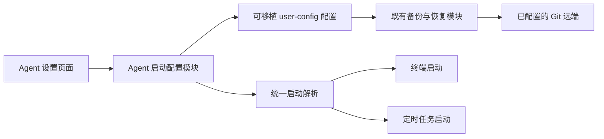

# Agent 启动设置原型与同步设计

本目录属于需求资料。本轮只完善可交互原型，不修改正式设置、配置存储、运行中的 Agent 或远端 Git 仓库。

## 已明确的要求

- 以项目实际支持的完整 Agent 清单为准，目前为 54 项；未安装的 Agent 也有可编辑的预填启动指令。
- 每个 Agent 一行完整指令，命令和参数直接编辑；少量常用参数按钮与同一行指令双向联动。
- 没有聊天模式，也没有模型选择；使用各 Agent 自身的默认模型。
- 完整保留现有字段与功能：安装与启停状态、自定义 Agent、技能目录、项目技能路径、路径覆盖标记、分组、排序、添加、移除、保存、取消、恢复默认和刷新。
- 可展开区域叫“详细设置”。大量 Agent 通过搜索、筛选和分组折叠浏览。
- 新增启动配置必须支持既有 Git 同步备份，配置、同步及展示分别维护。

项目的“支持 Agent”表示适配和技能管理能力，不保证每项都有独立 CLI。预填指令是配置建议；IDE、扩展使用其宿主入口。原型没有执行或验证全部预填指令。

## 原有功能对照

对照来源：[正式设置页](../../../src/components/settings/AgentsSettings.tsx)、[设置控制器](../../../src/hooks/useAgentSettings.ts)、[Agent 卡片](../../../src/components/settings/AgentSettingsCard.tsx)、[自定义表单](../../../src/components/settings/AddCustomAgentForm.tsx)。

| 正式功能                   | 原型对应行为                                                          |
| -------------------------- | --------------------------------------------------------------------- |
| 完整字段                   | 保留全部 ToolInfo 字段，仅追加启动指令；路径中的主目录已脱敏          |
| 单项启停、未安装禁用       | 原有开关与禁用条件保留                                                |
| 全部启用、全部禁用         | “更多”中保留，计数随之更新                                            |
| 已检测、未检测、自定义分组 | 三组分别展示；其他智能体可折叠                                        |
| 拖拽排序                   | 复用正式 AgentGroupDnd，排序只改变所属分组的位置，不丢失其他字段      |
| 路径编辑                   | 编辑、Enter 保存、Escape/取消放弃；空技能目录不能保存，项目路径可清空 |
| 选择技能目录               | 原型目录对话框，选择后仍可取消编辑；不读取真实文件系统                |
| 恢复路径默认值             | 只对存在覆盖的内置 Agent 显示；自定义 Agent 不伪造内置默认路径        |
| 自定义 Agent               | 名称、技能目录、项目路径全部保留，追加启动指令；支持选择目录          |
| 移除自定义 Agent           | 先确认再移除；取消保持数据，目录内容不删除                            |
| 计数                       | 已安装、已启用、自定义及设置导航数量联动                              |
| 刷新                       | 演示加载和完成状态，保留已编辑配置与顺序；不冒充真实安装扫描          |

## 现有 Git 备份能力

现有 [user_config](../../../src-tauri/src/core/user_config.rs) 已提供独立的可移植配置树、路径检查和容量约束。[备份投影](../../../src-tauri/src/core/backup_workspace/user_config.rs) 在现有仓库锁下导出、暂存、发布并恢复配置；[自动备份](../../../src-tauri/src/core/auto_backup.rs) 复用防抖、失败退避和状态事件。

因此正式接入应沿用现有 Git 远端、凭据、同步锁、合并及恢复流程，不另建 GitHub 上传器，不让设置页面直接执行 Git。现有功能目前没有为 Agent 启动指令提供独立持久化模块；下述接入属于后续实现设计。

## 独立模块与接口

- 启动配置模块提供读取、按修订保存、恢复默认和解析有效指令的接口，负责缺省值、兼容性与输入校验。页面、终端和任务消费同一个结果，不各自维护命令拼装规则。
- 保存保留用户编辑的完整指令；跨平台指令解析和 argv 生成集中实现，保存或恢复不执行命令。
- 可移植文档建议保存为 `user-config/agents/launch.json`，包含格式版本、默认 Agent 和按稳定 key 记录的启动指令覆盖值。未修改的内置默认值从适配定义读取。
- 既有字段继续使用既有来源，新增文档不替代完整 ToolInfo，不迁移或清空技能路径、排序及自定义定义。安装检测、凭据、运行状态和本机绑定不随启动指令同步。
- 保存后通知既有自动备份；真实同步成功需依据备份模块的结果，不能以“本地已保存”或 Agent 空闲代替远端完成。
- 恢复由既有备份事务控制，并在发布前调用启动配置模块校验内容。遇到并发修改保留双方数据；旧备份缺少此文档时不清空当前配置。
- 远端恢复只影响后续启动；不重启、打断或替换正在运行的 Agent。当前设备不认识的 Agent key 应保留其覆盖值，不能因未安装而丢弃。

## 原型中的模块

- `agentLaunchDocument`：从当前页面生成可移植启动配置，仅包含默认 Agent 与指令覆盖值。
- `useAgentSyncPrototype`：独立的内存同步适配器，维护待同步、同步中、成功、失败及冲突；无 Git、IPC 和文件写入。
- `AgentSyncPanel`：只消费同步状态与动作，复用于 Agent 页状态条和“同步与备份”演示页。
- 详细设置的修改不改变启动配置文档。采用远端指令只更新启动指令及默认 Agent，保留其他字段。

## 验证与后续验收

已在实际预览中检查：路径编辑、取消、模拟选目录、保存、清空项目路径、恢复默认；添加自定义 Agent 与字段/分组/计数联动；取消移除及确认移除；修改指令变为待同步；正常同步、连接失败、重试、冲突对比和采用远端配置。已检查全部 54 项与项目清单一致，且所有原字段均保留。

拖拽复用了正式组件并保留组内排序逻辑，尚未进行真实指针拖动验收。文件夹选择、安装刷新和 Git 同步均为演示，不能据此声称原生或远端功能已经实现。

正式实现应优先从完整的“保存配置 → 既有 Git 备份 → 另一份隔离配置库恢复”接口验证，补充旧功能回归；覆盖本地保存与上传失败分离、同步中继续编辑、冲突两种处理、旧备份、未安装 Agent、未知 key，以及恢复不改变运行中任务。

## 运行

`./prototype.sh agent-settings`，或 `npm run prototype:agents`。所有演示状态只保留在当前页面。

## 实施时的最终布局确认

正式页面顶部复用原型的同步状态条与筛选工具栏，两行控制：同步入口单独清晰展示；已安装、已启用、全部筛选与搜索、添加自定义、更多批量操作并列。去除重复统计与长说明。下方保持原卡片内容和详细设置，宽窗口每行两个，窄窗口一列；不将卡片本身强行压成两行。
